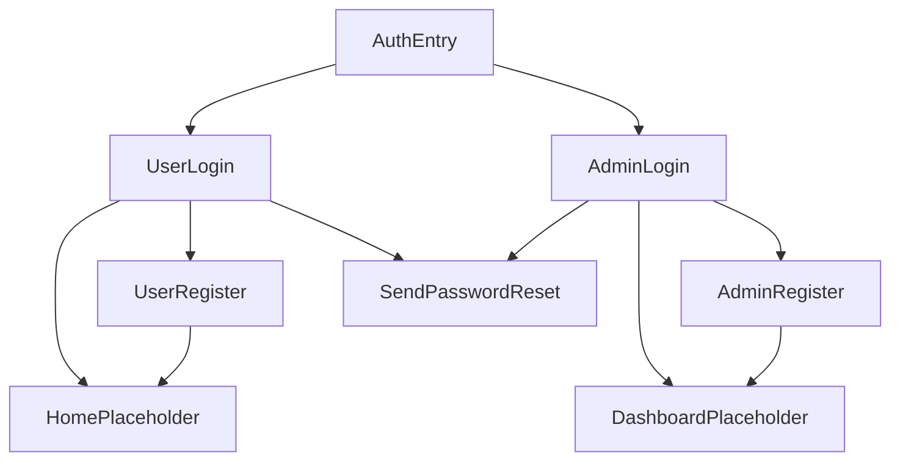

# Email and password authentication

Separate admin and user flows. Register collects email and password only. This replaces the earlier “users-only registration with name and profile image” rule for this feature.

After a successful sign-in or registration, admin goes to a placeholder Dashboard and user goes to a placeholder Home. Those screens are titles only so the redirect has a destination. Check-in, user lists, and profile images stay out of this change.

Forgot password is a button on each login screen. It sends a Firebase reset email to the address already typed in the email field and shows a snackbar. There is no third screen.

## Packages and startup

Add `firebase_auth`, `cloud_firestore`, `flutter_bloc`, and `bloc`. `firebase_core` is already in [pubspec.yaml](pubspec.yaml).

In [lib/main.dart](lib/main.dart), call `WidgetsFlutterBinding.ensureInitialized()` and `Firebase.initializeApp()` before `runApp`. Native config is already in `android/app/google-services.json` and `ios/Runner/GoogleService-Info.plist`, so no `firebase_options.dart` is added. Move `MaterialApp` into [lib/app.dart](lib/app.dart), which builds the repository and use cases and passes them into the router. Remove the counter page. Update [test/widget_test.dart](test/widget_test.dart) so it no longer expects the counter.

## Domain

`features/auth`, pure Dart plus `core/error`.

- `UserRole` is `admin` or `user`.
- `AppUser` has `id`, `email`, and `role`.
- `AuthRepository` methods: `signIn`, `register`, `sendPasswordReset`, `currentUser`, `signOut`.
- Use cases: `SignIn`, `RegisterAccount`, `SendPasswordReset`, `GetSignedInUser`.

`SignIn` and `RegisterAccount` take the role of the screen that submitted the form.

- Empty email or password returns `ValidationFailure` and does not call the repository.
- `SignIn` loads the profile after Firebase auth. If the stored role is not the screen’s role, it signs out and returns `ValidationFailure` (`This account is not an admin.` or `This account is not a user.`).
- A missing profile returns `FirebaseFailure` and signs out.
- `SendPasswordReset` returns `ValidationFailure` when email is empty.

Password reset needs a value inside `Success`, and `Result<void>` cannot hold one. Add a const `Unit` in [lib/core/error/unit.dart](lib/core/error/unit.dart) and return `Result<Unit>`.

## Data

Firebase stays in the data layer. `AuthRemoteDataSource` calls `FirebaseAuth` and Firestore. `AuthRepositoryImpl` catches exceptions and returns `ResultFailure(mapToFailure(error))`. Existing mapper copy is reused for wrong password, weak password, email in use, and network errors.

On register, create the auth user, then write `users/{uid}` with `email`, `emailLower`, and `role`. No name and no photo. The role value is the one passed from that flow.

## Presentation and navigation

One `LoginPage` and one `RegisterPage`, each constructed with a `UserRole`. Separate `LoginBloc` and `RegisterBloc` instances are provided on each route. Blocs call use cases only. Pages send events. `BlocListener` navigates and shows snackbars. `BlocBuilder` shows loading and `failure.message`. Ignore a second tap while loading.

`AuthEntryPage` offers User and Admin. `AuthEntryBloc` runs `GetSignedInUser` on start and redirects by the stored role. A signed-in user who opens either login is redirected by that stored role.

Named routes live in [lib/core/router/app_router.dart](lib/core/router/app_router.dart). No `go_router`. This router file is the one core file that imports feature pages. Other core files stay free of features.

- `/` entry
- `/user/login`, `/user/register`
- `/admin/login`, `/admin/register`
- `/home` placeholder in `features/attendance`
- `/dashboard` placeholder in `features/admin_dashboard`

Colors come from `Theme.of(context).colorScheme`.

## Tests

Hand-written fakes, no mock packages. Cover:

- empty email or password does not call the repository
- user registration writes `UserRole.user`; admin registration writes `UserRole.admin`
- admin sign-in rejects a user profile, signs out, and returns `ValidationFailure`
- user sign-in rejects an admin profile the same way
- forgot password with an empty email returns `ValidationFailure`
- forgot password with an email calls the repository

Run `flutter test` for the new use case tests and the updated widget test.
